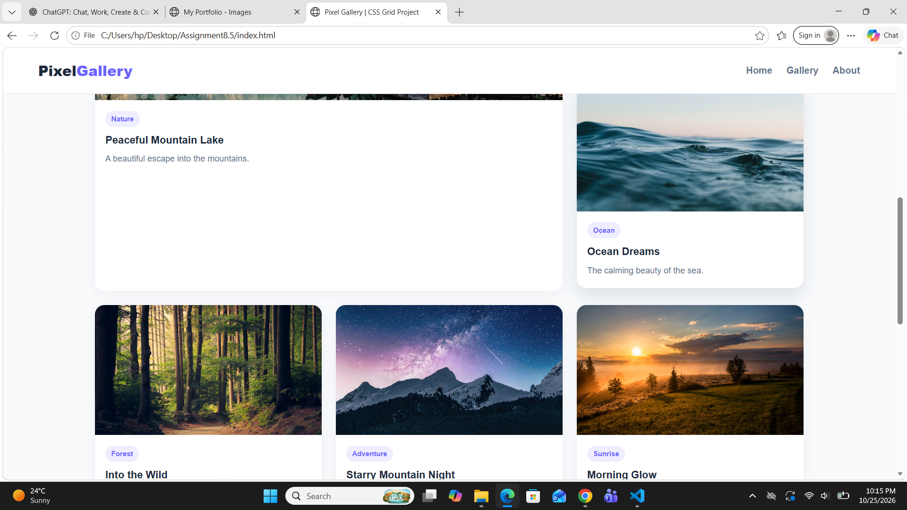
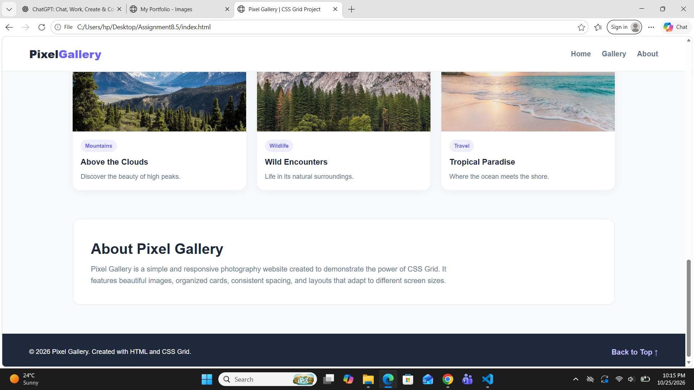
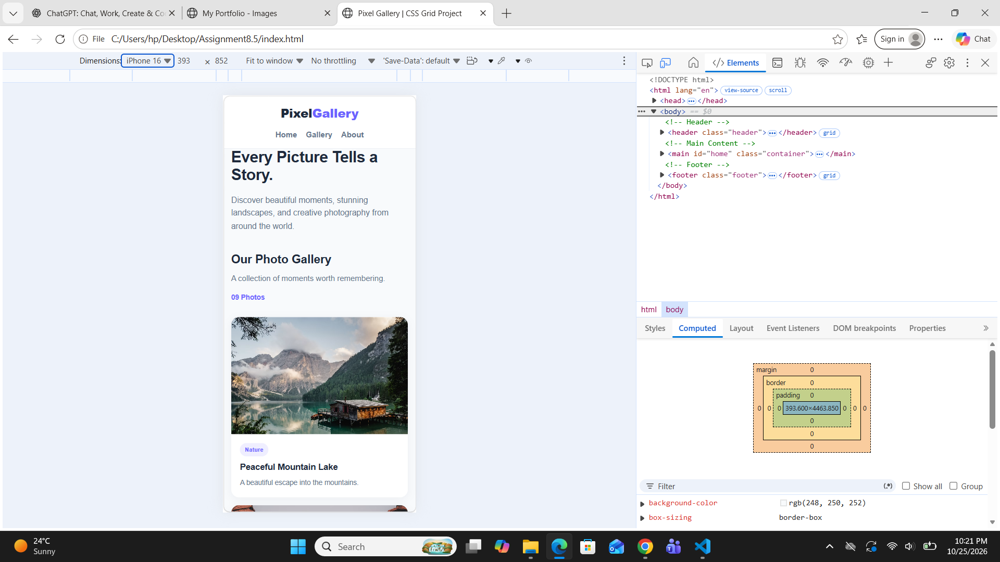
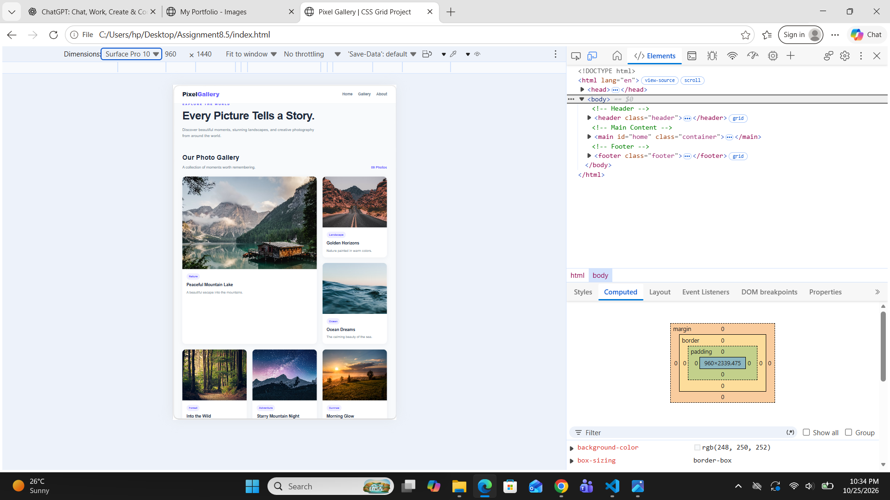

# Assignment 8.5 — CSS Grid Mini-Project

## 1. Aim

The aim of this assignment is to design and develop a responsive photo-gallery website or dashboard page using CSS Grid. The project demonstrates the use of modern CSS layout techniques to arrange multiple cards and images in a structured, attractive, and responsive manner.

## 2. Introduction

CSS (Cascading Style Sheets) is used to control the appearance and layout of HTML webpages. CSS Grid is a two-dimensional layout system that allows developers to arrange elements into rows and columns.

In this assignment, a complete photo-gallery website or dashboard page is created with a header, a main grid layout, multiple cards or images, consistent spacing, responsive columns, and a footer. The layout is designed to adapt to different screen sizes, including desktops, tablets, and mobile devices.

## 3. Theory of CSS Grid

CSS Grid is a powerful CSS layout system used to create complex webpage structures. It allows elements to be positioned along both horizontal and vertical axes.

The `display: grid` property defines a grid container. Its child elements automatically become grid items, which can be arranged into rows and columns using different grid properties.

CSS Grid is particularly useful for photo galleries and dashboards because it provides control over the size, position, alignment, and spacing of elements.

## 4. Important CSS Grid Properties

### A. `display: grid`

This property converts an HTML element into a grid container. Its child elements can then be arranged using CSS Grid properties.

### B. `grid-template-columns`

This property defines the number and size of columns in a grid. It can create equal-width columns or columns with different dimensions according to the design requirements.

### C. `repeat()`

The `repeat()` function reduces repetition when defining multiple rows or columns with similar sizes. It makes CSS code shorter, cleaner, and easier to maintain.

### D. `minmax()`

The `minmax()` function specifies a minimum and maximum size for a grid track. It helps grid columns adjust to the available space while maintaining suitable dimensions.

### E. `fr` Unit

The `fr` unit represents a fraction of the available space in a grid container. It distributes remaining space among columns or rows according to their fractional values.

### F. `gap`

The `gap` property defines the spacing between grid rows and columns. Consistent gaps improve the appearance and readability of a gallery or dashboard.

### G. Named Grid Areas

CSS Grid supports named areas through properties such as `grid-template-areas` and `grid-area`. Named areas make it easier to organize major webpage sections, such as the header, main content, sidebar, and footer.

Alternatively, explicit grid placement can be used to specify the row and column positions of individual grid items.

## 5. Main Components of the Project

### A. Header

The header is the top section of the webpage. It may contain the website title, logo, navigation menu, or other introductory information. It helps users identify the website and navigate its content.

### B. Main Grid Layout

The main section contains the primary content of the website. CSS Grid is used to organize the gallery items or dashboard cards into rows and columns.

### C. Multiple Cards and Images

Cards are used to display individual images or pieces of information. Each card may contain an image, title, description, or other relevant details. Consistent sizing and spacing create a uniform design.

### D. Consistent Gaps

Consistent spacing between grid items makes the layout more organized and visually appealing. The `gap` property provides a convenient way to maintain uniform spacing throughout the grid.

### E. Responsive Columns

Responsive design allows the webpage to adapt to different screen widths. CSS Grid can automatically adjust the number and size of columns based on the available space.

Media queries can also be used to modify the layout for mobile phones, tablets, and desktop screens.

### F. Footer

The footer is the bottom section of the webpage. It may contain copyright information, contact details, social media links, or other supplementary information.

## 6. Preventing Overflow

Overflow occurs when images or text extend beyond the boundaries of their containers. It can negatively affect the layout, especially on smaller screens.

To prevent overflow:

- Images should be sized to fit within their containers.
- Appropriate image-fitting properties should be used to maintain the desired appearance.
- Long text should wrap within its container.
- Grid items should be allowed to shrink when necessary.
- Container widths should be managed carefully to avoid unwanted horizontal scrolling.

These techniques help maintain a clean and usable layout across different devices.

## 7. Responsive Web Design

Responsive web design ensures that a webpage displays correctly on devices with different screen sizes and resolutions.

CSS Grid supports responsive layouts through flexible column sizing, the `repeat()` and `minmax()` functions, fractional units, and media queries.

For example, a gallery may display several columns on a desktop, fewer columns on a tablet, and a single column on a mobile phone. This improves usability and ensures that images remain accessible on smaller screens.

## 8. Screenshots

## PHOTO GALLERY WEBSITE ON DIFFERENT SCREENWIDTH

## 9. Advantages of CSS Grid

1. It provides precise control over rows and columns.
2. It simplifies the creation of complex webpage layouts.
3. It supports responsive and flexible designs.
4. It reduces the need for complicated positioning techniques.
5. It makes it easier to maintain consistent spacing.
6. It is suitable for image galleries, dashboards, portfolios, and other modern websites.

## 10. Applications of CSS Grid

CSS Grid is commonly used in:

- Photo-gallery websites.
- Administrative dashboards.
- Portfolio websites.
- Product listing pages.
- News and magazine layouts.
- Educational websites.
- Responsive landing pages.

## 11. Conclusion

In this assignment, I learned how to create a responsive photo-gallery website or dashboard using CSS Grid. I understood the use of `display: grid`, `repeat()`, `minmax()`, fractional units, gaps, and named grid areas or explicit grid placement. I also learned how to arrange cards and images, prevent overflow, and adapt webpage layouts to different screen sizes. This assignment improved my understanding of modern CSS layout techniques and their application in developing responsive, well-structured, and user-friendly websites.